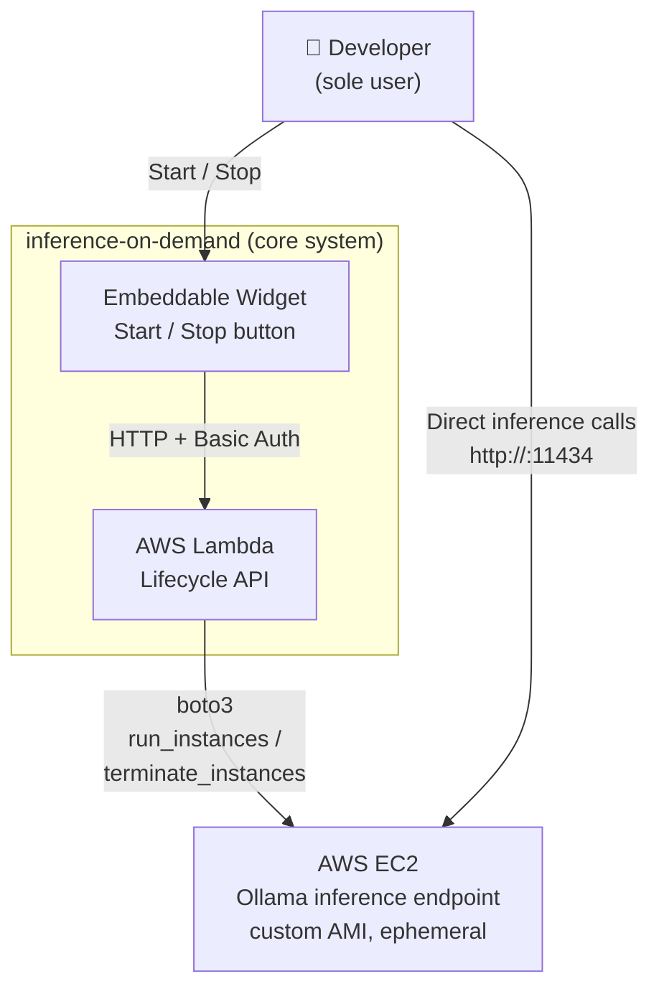

# C1 — System Context

## Notes

- Inference traffic goes directly from the client to the EC2 instance's public IP on port 11434 — Lambda is never in the inference path (avoiding API Gateway and Lambda execution timeout limits).
- Lambda manages the EC2 lifecycle via boto3 — no Terraform is invoked at runtime.
- EC2 is terminated (not stopped) on every session end — every session starts from a clean AMI.
- Terraform is used only for persistent infrastructure (`deploy/aws/`) — not involved at runtime.