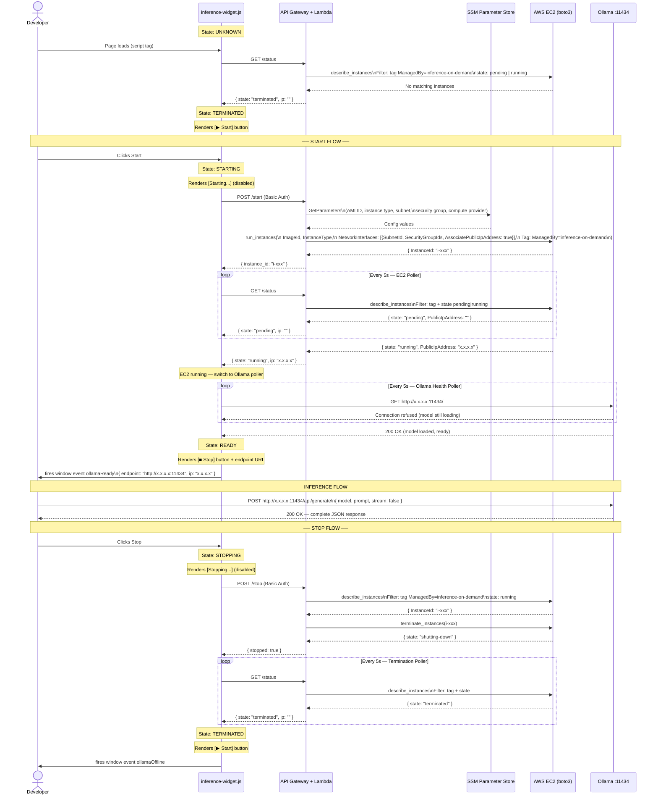

# Sequence Diagram — End-to-End User Interaction & State Transitions

## Notes

- **Tag-based lookup** — EC2 instances are tagged `ManagedBy=inference-on-demand` at launch. `stop.py` and `status.py` always query by tag — no instance ID stored in SSM.
- **Two-stage polling** — EC2 Poller waits for `running` state with an allocated public IP. Ollama Health Poller then waits for 200 OK directly on `:11434`. ~30–60s gap between the two while the model loads.
- **Fast Stop** — `terminate_instances` via boto3 initiates immediate instance shutdown.
- **Inference is direct** — Developer calls `http://<ec2-public-ip>:11434` directly. Lambda is never in the inference path.
- **Page reload resilience** — Widget calls `GET /status` on load. `status.py` queries EC2 by tag — if an instance is running, widget recovers to STARTING or READY without a new launch.